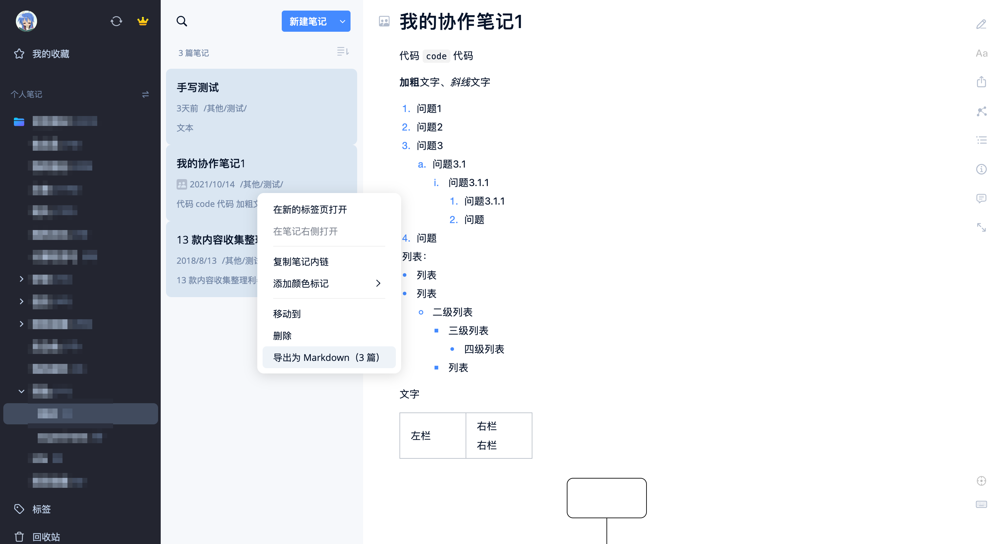
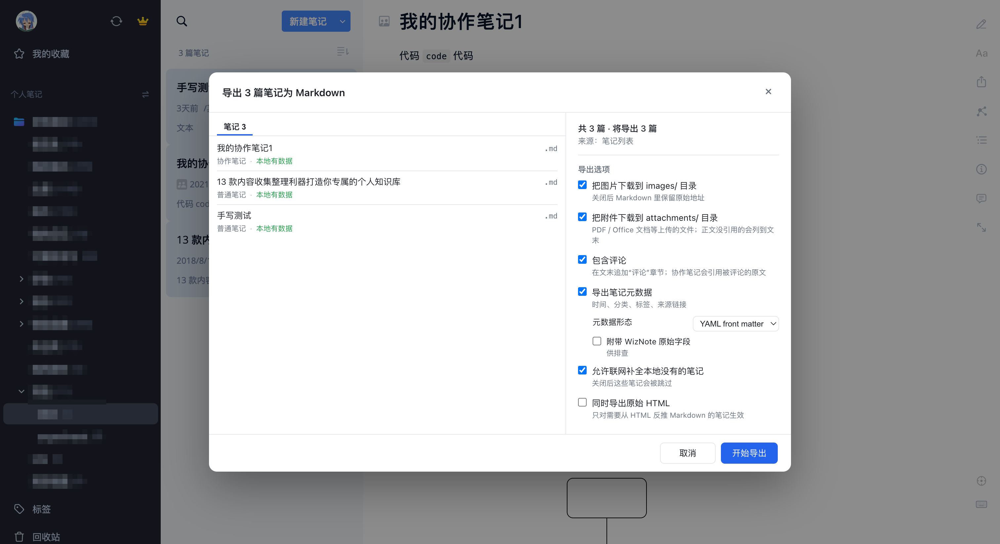
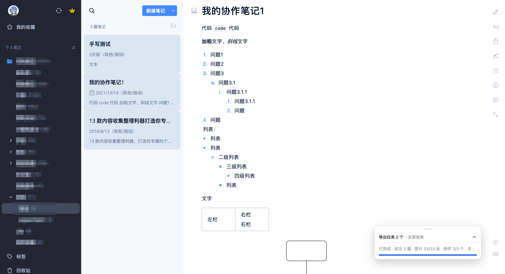
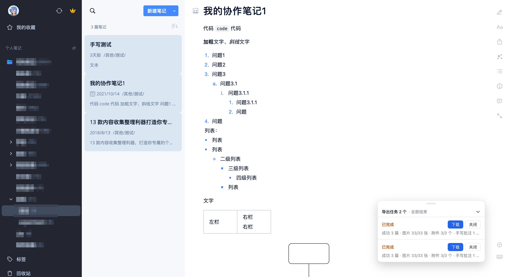
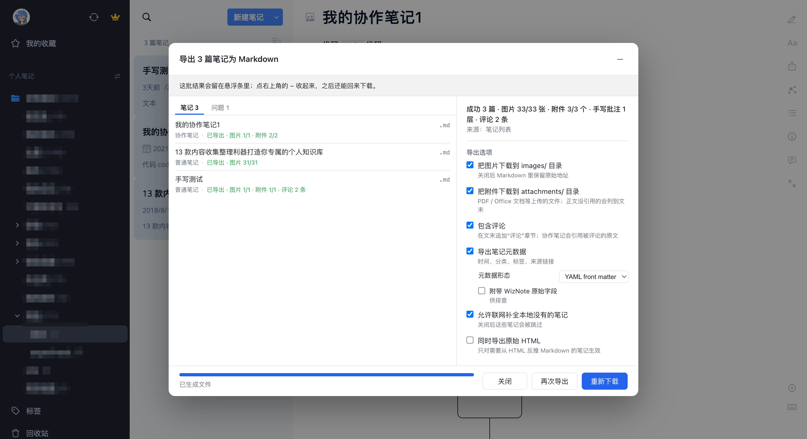
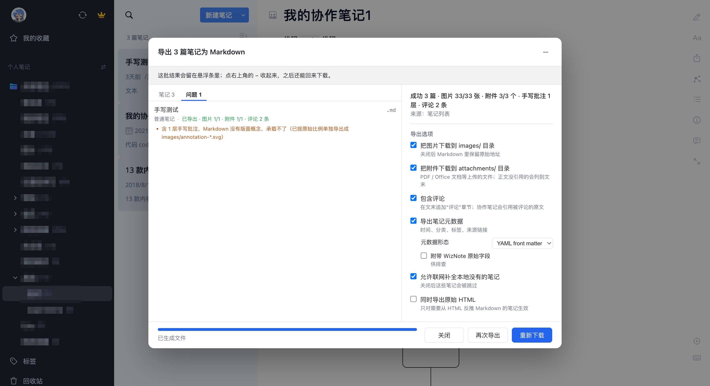
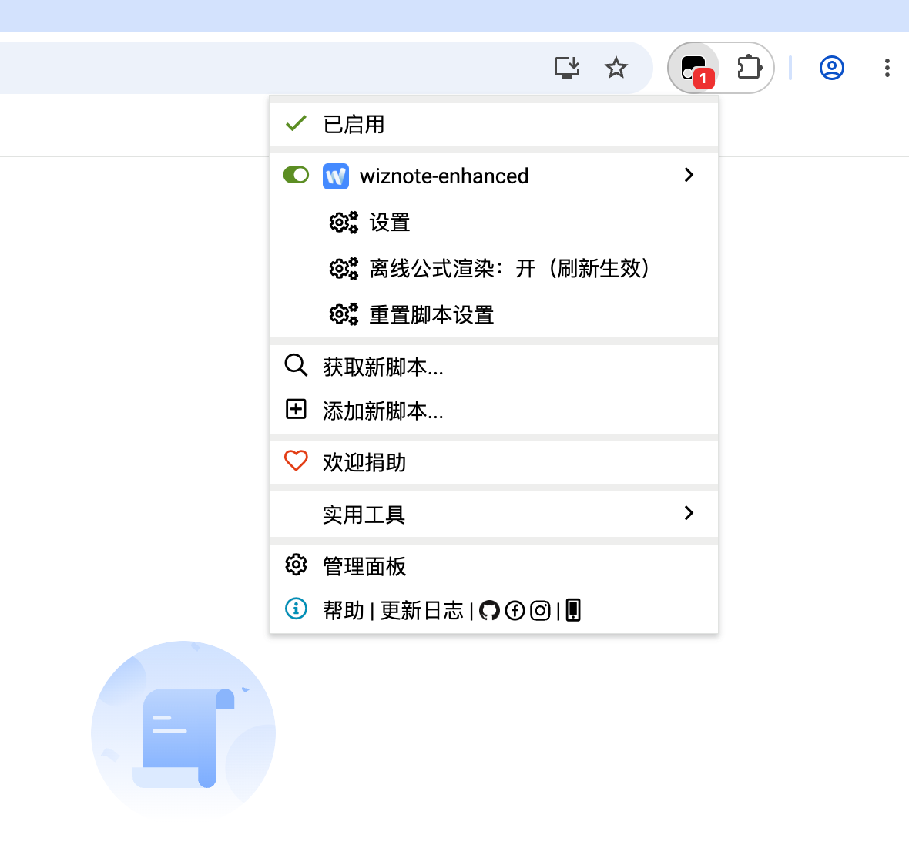
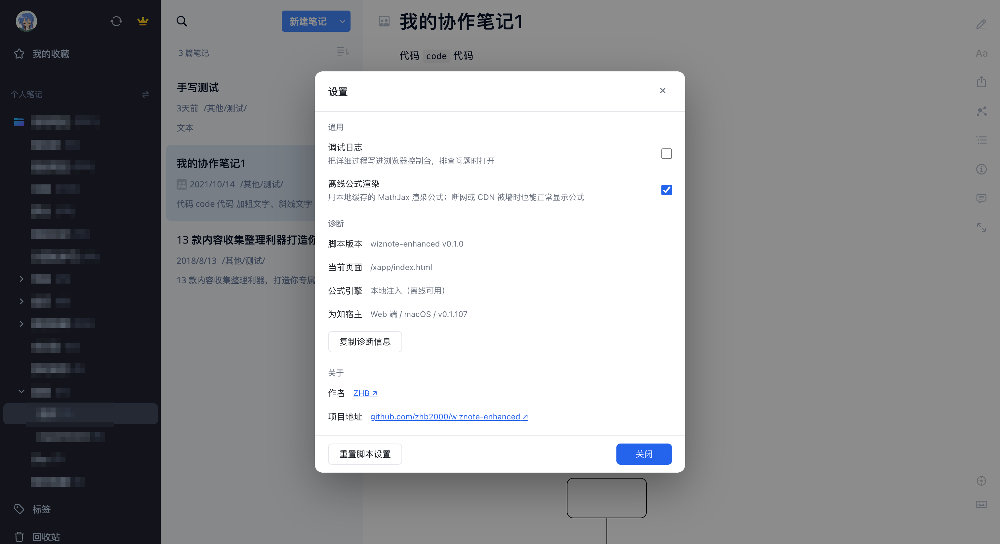

# wiznote-enhanced: 为知笔记增强脚本

为知笔记网页版（<https://www.wiz.cn/xapp>）的增强油猴脚本。

功能：

- **导出笔记为 Markdown** —— 笔记列表 / 阅读界面右键导出，支持批量、图片、附件、评论、元数据导出。
- **修复离线公式渲染** —— 为知笔记的 MathJax 是运行时从第三方 CDN 拉的，PWA 断网后数学公式会报错 `window.MathJax.tex2svgPromise is not a function`，脚本内置了一份 MathJax 引擎绕过它。

已适配为知笔记桌面端网页版 v0.1.107。

## 安装

1. 浏览器安装油猴扩展程序：[Tampermonkey（篡改猴）](https://chromewebstore.google.com/detail/tampermonkey/dhdgffkkebhmkfjojejmpbldmpobfkfo) 或 [Violentmonkey（暴力猴）](https://chromewebstore.google.com/detail/violentmonkey/jinjaccalgkegednnccohejagnlnfdag)。
2. 安装本项目脚本：打开 <https://github.com/zhb2000/wiznote-enhanced/releases/latest/download/wiznote-enhanced.user.js>，油猴会弹出安装确认。
3. 打开新版为知笔记（<https://www.wiz.cn/xapp>）并登录，右键任意笔记就能看到菜单项。

脚本的更新源指向 GitHub Release，油猴会定期检查新版本并提示（是否自动安装取决于你的油猴设置），平时不需要手动更新。

## 使用

### 导出为 Markdown

#### 发起导出任务：

1. 在笔记列表或阅读界面**右键 → “导出为 Markdown”**（支持多选后右键导出多篇笔记）。

  
   
  在笔记列表 / 阅读界面右键 → “导出为 Markdown”

2. 弹出导出对话框 → 勾选所需选项 → “开始导出” → 完成后将自动下载。

  
   
  在导出对话框中勾选选项 → “开始导出”

#### 导出期间

- 对话框右上角按钮变为**最小化按钮**：点击（或按 Esc）把对话框收成右下角的**悬浮任务条**，导出在后台继续。在此期间，你可以继续浏览笔记或发起其他导出任务。
- 悬浮条**顶部把手**用于拖动位置，双击把手回到右下角。

  
  
   
  左：收起态，右：展开态；顶部把手可拖动，双击回到右下角

#### 导出结果提示

对话框左侧逐篇列出状态（成功 / 跳过 / 失败、图片 N/M 张、附件 N/M 个），导出时有问题的笔记会单独汇总到“问题”页。

  
  
   
  图 4：左：逐篇结果列表，右：“问题”页

**导出产物**：

| 场景 | 产物 |
| --- | --- |
| 单篇，没有图片或附件 | 一个 `.md`（不支持的笔记类型导出为 `.html`） |
| 单篇，有图片或附件，且勾选了对应的下载选项 | 一个 zip，内含同名 `.md` + `images/`、`attachments/` |
| 多篇 | 一个 zip，每篇一个同名文件夹 |

### 导出选项

| 选项 | 默认 | 说明 |
| --- | --- | --- |
| 把图片下载到 `images/` 目录 | 开 | 关闭后 Markdown 里保留原始链接地址，不打包图片 |
| 把附件下载到 `attachments/` 目录 | 开 | 笔记里上传的 PDF / Office 文档等，保留上传时的原始文件名。 |
| 包含评论 | 开 | 在文末追加“评论”章节 |
| 导出笔记元数据 | 开 | 时间、分类、标签、来源链接 |
| 元数据形态 | yaml | `yaml` 写进正文开头的 front matter；`json` 落盘为同名 `.meta.json` |
| 附带 WizNote 原始字段 | 关 | 元数据带上 `docGuid` / 原始 `type` 等，排查用 |
| 允许联网补全本地没有的笔记 | 开 | 关闭后这些笔记会被跳过（预检里会实时显示会跳过几篇） |
| 同时导出原始 HTML | 关 | 作为有损转换的保真备份 |

### 笔记类型与产物

支持程度按笔记类型不同，不支持的会导出原始 HTML 兜底并在结果里说明：

| 类型 | 产物 |
| --- | --- |
| 协作笔记 | `.md` |
| 普通笔记（富文本、网页剪藏、任务列表等） | `.md` |
| 旧版 Markdown 笔记 | `.md`（从 HTML 反推并做反转义） |
| Lite Markdown 笔记 | `.md`（直接取 markdown 原文） |
| 大纲笔记 | `.md`（嵌套列表，层级靠缩进表达） |
| 旧版 `.mj` 公式笔记 | `.html` |

笔记里的**手写批注层**（覆盖在版面上的标注）会单独导出为 SVG，并在 Markdown 末尾附上说明。Markdown 不支持渲染手写批注，若需要保留手写批注效果，请勾选“同时导出原始 HTML”。

### 设置

**油猴菜单 → wiznote-enhanced → “设置”** 打开脚本的设置对话框。

  
   
  油猴菜单 → wiznote-enhanced → “设置”

设置对话框内含脚本自身的全局设置项与诊断信息：

- 调试日志（默认关闭；排查问题时打开，输出前缀 `[wiznote-enhanced]`）
- 离线公式渲染（改动后需刷新页面）
- 脚本版本 / 当前页面 / 公式引擎来源 / 为知宿主
- 复制诊断信息、重置脚本设置（重置会先确认一次，并说明哪些东西会回默认）
- 关于：作者主页与项目地址

  
   
  图 5：脚本设置对话框（含“调试日志”开关与诊断信息）

## 权限与隐私

| 权限 | 用途 |
| --- | --- |
| `GM_getValue` / `GM_setValue` / `GM_deleteValue` | 保存脚本设置（存在油猴自己的存储里） |
| `GM_registerMenuCommand` | 注册油猴菜单入口 |
| `GM_addStyle` | 往页面注入菜单项样式 |
| `GM_notification` | 后台导出任务跑完时发系统通知 |
| `unsafeWindow` | 访问页面上的 `window.LiveEditor` / `window.wizApp`（导出必需） |

- 脚本**不收集、不上传任何数据**；所有逻辑都在浏览器中执行，导出产物也只落在本地。
- 联网请求只在导出时发生，且只发往 `wiz.cn`（取笔记内容、图片与附件）。
- 访问令牌（`token`）只用于这些取数请求，不会写进任何产物或日志。
- 想要彻底不让脚本联网：关闭“允许联网补全本地没有的笔记”，仅使用本地缓存数据导出笔记。

## 已知限制

- 只支持新版为知笔记桌面端页面（<https://www.wiz.cn/xapp>）。移动端页面（<https://www.wiz.cn/mapp>）、旧版页面（<https://www.wiz.cn/wapp>）不在支持范围内。
- 依赖应用内部结构，为知笔记上游改版可能导致失效。

## 常见问题

**右键菜单里没有“导出为 Markdown”？** 先确认当前页面是 `wiz.cn/xapp`，并在油猴里确认脚本已启用；脚本启动后 `.wiz-menu-item` 才会被注入。若仍然没有，**打开脚本设置里的“调试日志”**，看浏览器控制台中以 `[wiznote-enhanced]` 开头的日志信息。 

**导出很慢？** 图片和附件都是串行下载的，网络请求之间设有节流，间隔 60ms，避免瞬间打满服务端，图片多或附件大的笔记会有点慢。

**“图片没取到”？** 大概率为知服务端那边已经没有了（返回 404 / 403，或者只回一张 1×1 的占位图），为知笔记自己也同样无法取到这些坏图。

**页面 UI 打不开 / 报错？** 尝试用油猴菜单里的“重置脚本设置”，它会清掉脚本的存储并恢复默认。然后刷新网页。若仍然存在问题，请打开脚本的调试日志，观察控制台是否有错误信息。

**导出结果不对 / 想反馈问题？** 反馈问题时请附上**详细的控制台日志**和诊断信息（设置 → 复制诊断信息）。
